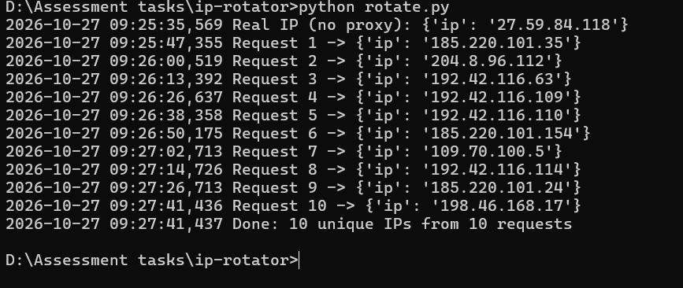

# IP Rotating Requests (Tor)

Sends repeated requests to `https://api.ipify.org/?format=json`.
Every request leaves from a different public IP. Each response is logged.

## How it works

1. Requests go through Tor (`socks5h://127.0.0.1:9050`).
2. Before every request, `stem` sends the `NEWNYM` signal to Tor's control port.
3. Tor builds a new circuit, so the exit IP changes.
4. If Tor returns an IP already used, the script rotates again (max 3 tries).
5. Everything is logged to the console and `ips.log`.

`socks5h` makes DNS resolve through Tor too, so no DNS leak.

## Setup

Requires Python 3.9+ and Tor.

**1. Install Tor**
- Ubuntu: `sudo apt install tor`
- Windows: download the *Tor Expert Bundle* from torproject.org and run `tor.exe -f torrc`
- Mac: `brew install tor`

**2. Configure Tor.** Create a password hash: `tor --hash-password mypass`. Add to `torrc` (Linux: `/etc/tor/torrc`):

```
SocksPort 9050
ControlPort 9051
HashedControlPassword <paste hash here>
```

Restart Tor (Linux: `sudo systemctl restart tor`).

**3. Install and run**

```bash
pip install -r requirements.txt
export TOR_PASSWORD=mypass          # Windows CMD: set TOR_PASSWORD=mypass
python rotate.py
```

Ten requests take about two minutes. Tor needs ~10 seconds between new circuits.

## Expected output

```
Real IP (no proxy): {'ip': '103.x.x.x'}
Request 1 -> {'ip': '185.220.101.4'}
Request 2 -> {'ip': '171.25.193.78'}
...
Done: 10 unique IPs from 10 requests
```

## Configuration

Edit the constants at the top of `rotate.py`: `REQUEST_COUNT`, `DELAY`, `MAX_TRIES`, `CONTROL_PORT`.

## Notes

- Tor has a limited exit pool. Duplicates can happen, so the script retries.
- Rotating faster than ~10 s is ignored by Tor.

## Screenshots


